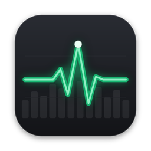

# PulseBar

An app-centric activity monitor and process inspector for macOS 15+ and Linux, written in Rust,
aimed at developers who run AI agents, dev servers and Docker. Every metric is attributed to the
**application** responsible for it ("922 processes → 62 apps"), and the same data is exposed to
the menu bar (status icons on Linux), a main window, a CLI and an (opt-in) MCP server.

**Privacy:** everything is computed on your machine. The code base opens no TCP connections; Docker is a
local unix socket; AI-plan usage is read from the agents' own local logs. The only two permitted
network calls (update check, licence validation) live in `src/net_policy.rs` and are off unless
enabled. No telemetry, no account, no analytics.

## Architecture

Two processes, so the always-on part stays small:

| Process | Command | Does | Footprint (measured, M3 Pro, ~780 processes) |
|---|---|---|---|
| Menu bar agent | `pulsebar app` (Finder launch) | status items, sampling, history, alerts, `live.json` | **~23 MB**, ~2.4 % of one core (≈0.2 % of the Mac) |
| Window | `pulsebar window` (spawned on demand) | egui window, 1 s sampling while open | ~220 MB while open (GPU surfaces); exits on close |

They exchange small files in `~/Library/Application Support/PulseBar/` (`live.json`, `alerts.json`,
`snoozes.json`, `nav.json`, `pending/`, `settings.json`), which the CLI and MCP server use too.

```
src/
  collectors/   M1  CPU, memory, disk, network, GPU (ioreg), ANE/CPU/GPU power (IOReport),
                    temperatures + fans (sysinfo/SMC), battery (AppleSmartBattery), audio
                    (CoreAudio HAL), Bluetooth (system_profiler); process sampler (libproc,
                    proc_pid_rusage: footprint, peak, CPU times, disk I/O, billed energy; nettop)
  grouping.rs   M2  apps-not-processes (bundle → responsible pid → parent chain → macOS/daemon)
  inspector.rs  M3  identity, code signature / Team ID / entitlements / sandbox / hardened
                    runtime, argv, cwd, CPU times, peak memory, open files, listening ports
  gui/tray.rs   M4  independent menu bar items: number / graph / both, framed, red threshold,
                    dropdown with family figures + top 5 apps → opens window at that app
  gui/app.rs    M5  13 tabs + History + Settings, Top Apps with expandable helpers, share cards,
                    per-app detail panel (click an app's name or the chart icon on hover)
  projects.rs, agents.rs, limits.rs, docker.rs   developer tabs
  history.rs    M6  single SQLite file, 1 s/1 min/5 min/30 min/2 h/6 h buckets, retention,
                    per-app series (cpu/memory/energy/disk/network) + alert/restart events
  alerts.rs     M7  sustained CPU, sustained memory growth, disk/network sustained
  mcp.rs        M8  stdio JSON-RPC MCP server (off by default)
  cli.rs, output.rs, views.rs   M9  CLI tables + JSON (schemas in schemas/)
  settings.rs, i18n.rs, units.rs, share_card.rs   M10
  actions.rs    every stop/quit goes through Plan → HumanYes → Confirmed → execute
```

## Build & run

```sh
make build                             # = cargo build --release
./target/release/pulsebar app          # menu bar agent (opens the window on first launch)
./target/release/pulsebar status       # CLI
make app                               # dist/PulseBar.app
make dmg                               # dist/PulseBar-<version>.dmg — open it, drag PulseBar to Applications
make install                           # build the app and copy it to /Applications
```

`make dmg SIGN_ID="Developer ID Application: …" NOTARY_PROFILE=pulsebar` signs with Hardened
Runtime and notarizes + staples the image (create the profile once with
`xcrun notarytool store-credentials pulsebar`). Without `SIGN_ID` the app is ad-hoc signed: fine on
this Mac, other Macs need right-click → Open the first time. The binary is universal when both
`aarch64-apple-darwin` and `x86_64-apple-darwin` rustup targets are installed. The app icon
(`packaging/AppIcon.icns`) is generated by `python3 packaging/icon/make_icon.py` (needs Pillow).

`cargo build --no-default-features` builds the CLI + MCP only (no GUI dependencies).
The Homebrew cask template is `packaging/pulsebar.rb` (installs from the dmg); it links the bundle executable as
`pulsebar`, and that same binary acts as the CLI when run from a terminal.

## CLI

```
pulsebar status | top cpu|memory|energy|disk|net [N] | ports | projects | agents | limits
pulsebar containers | process <pid> [--csv] | history <metric> [--range 12h|24h|7d|30d|12m] [--rank]
pulsebar stop --idle [--yes] | stop --pid N | stop --app NAME   (always asks unless --yes)
pulsebar card memory --dark          # 1200×630 share card → ~/Downloads
pulsebar config mcp on|off | data bits|bytes | temp c|f | reset-layout | show
pulsebar config login [on|off]   # open at login (needs PulseBar.app); no argument shows the state
```
Add `--json` to any read command; output validates against `schemas/*.schema.json`.

## MCP

Off by default. Enable it in Settings → MCP (or `pulsebar config mcp on`), then:

```sh
claude mcp add pulsebar -- /Applications/PulseBar.app/Contents/MacOS/PulseBar mcp
```

Tools: `pulsebar_status`, `pulsebar_top_apps`, `pulsebar_what_is_on_port`,
`pulsebar_list_projects`, `pulsebar_list_agents`, `pulsebar_list_containers`, `pulsebar_limits`,
`pulsebar_diagnose`, `pulsebar_request_quit`, `pulsebar_quit_status`. Data is limited to the
current user's processes. `pulsebar_request_quit` only queues a request; PulseBar opens its window
and nothing is stopped until a person clicks **Allow**.

## Tests

```sh
cargo test                       # 50 tests
UPDATE_GOLDEN=1 cargo test --test cli_golden   # accept intentional CLI output changes
cargo clippy --all-targets       # clean
cargo run --release --example tick_profile     # per-tick cost breakdown
PULSEBAR_SCREENSHOT=/tmp/overview.png pulsebar window --tab overview   # save the window as PNG and quit
```

Coverage: unit tests for every collector parser (ioreg/battery/Bluetooth/nettop/lsof/codesign
fixtures), grouping (Chrome → 1 row × 96 processes), projects/idle detection, agents, AI-plan
pacing, Docker, history buckets/retention, alert rules (including no false positive for a
one-minute batch job), confirmation gating; golden output + JSON Schema validation for every CLI
command (`tests/fixtures/snapshot.json`); MCP protocol and data-scoping tests.

## Linux

```sh
make install-linux     # binary, launcher and icon under ~/.local (PREFIX=… to change)
pulsebar window        # the window; `pulsebar app` also runs the status icons
```

Each runs once: starting either again brings up the window that's already open.

Building needs Rust and a C compiler (`build-essential`); `cargo build --no-default-features` gives
a CLI/MCP-only binary with no GUI dependencies. The window needs OpenGL and X11 or Wayland.

What each part reads, and what it degrades to when the source is missing:

| Area | Source | Without it |
|---|---|---|
| CPU, memory, disk, processes, ports | `/proc`, `/sys` | always available |
| App grouping | `.desktop` files, systemd units and AppImages | groups by executable name |
| Per-app network | `ss` (iproute2) | blank; only your own processes' sockets are visible |
| GPU | `nvidia-smi`, else amdgpu in sysfs | other drivers (Intel, Asahi) show the name only, no load |
| CPU power | RAPL | usually root-only: power comes from the battery instead |
| Temperatures, fans, battery | hwmon, `power_supply` | "not available" |
| Sound | `pactl` (PulseAudio or PipeWire) | "not available" |
| Bluetooth | `bluetoothctl` | "not available" |
| Status icons | StatusNotifierItem over D-Bus | stock GNOME needs the AppIndicator extension; otherwise `pulsebar app` opens the window |
| Notifications | `notify-send` | no notification; alerts still show in the window |

Differences from macOS: there is no per-process energy counter, so the GPU and Battery lists rank
by CPU and the Overview shows CPU by app; there is no Neural Engine, so its tab is hidden; there are
no code signatures, so the inspector omits them; per-process disk I/O is only visible for your own
processes (the system total still counts everyone's); and share cards stay SVG, with no PNG
conversion. App icons are read from PNG files, so apps with only an SVG icon get a letter tile.

## Known limitations

- **Menu bar red tint** is drawn on the item's icon (AppKit status-item titles are plain text).
- **Per-app volume** needs a CoreAudio process tap (macOS 14.4+); this version controls device
  volume and mic, and shows per-app Playing / Silent / Muted state.
- **Fans** are read-only (SMC). Writing fan speeds needs root on Apple silicon and is not implemented.
- **Neural Engine load** is estimated from ANE power (IOReport); Apple publishes no utilisation API.
  GPU time per app isn't exposed by macOS, so the GPU tab ranks apps by energy instead.
- **Per-app network** comes from `nettop` every 15 s.
- **Claude plan usage** needs a token budget in Settings (local logs have tokens, not %); Codex
  logs include the real %; Copilot/Cursor are manual entry.
- **Localisation** covers tab names and common labels in 12 languages via an in-code table.
- Only tested on Apple silicon; Intel builds compile into the universal binary, but IOReport power isn't available on Intel.
- **Nothing theme** (Settings → Appearance) styles the main window only. The menu bar and exported
  share cards keep their own look, and the tab icons are the same glyphs as in the other themes.

## Fonts

The Nothing theme embeds Space Grotesk, Space Mono and Doto (`assets/fonts`), all under the SIL Open
Font License; the licences sit next to the fonts and ship in the app bundle. Space Grotesk and Doto
are static instances of the Google Fonts variable files (egui only renders a font's default
instance), and Doto is subset to Latin. They are loaded only while the theme is on.

## History storage and per-app series

History is one SQLite file (`history.sqlite`). Every series is kept at five resolutions (1 min → 24 h,
5 min → 7 d, 30 min → 30 d, 2 h → 6 months, 6 h → 1 year), each capped by the retention chosen in Settings
(default 90 days). The per-app detail panel reads the `app_cpu`, `app_memory`, `app_energy`, `app_disk` and
`app_network` series of an app, plus an `events` table (alerts fired for the app, restarts = new main PID; a restart is also recognised when the app was absent for up to 2 minutes in between).

Which apps are stored: the top 15 by each of CPU, memory, energy, disk and network at every tick (apps with a
value of 0 don't qualify). In the app lists, rows of apps with recorded history are marked "History"; an app
outside that set shows only its live values in the detail panel.

Size impact (measured: ≈ **79 B/row** including page overhead, for per-app rows that carry the bundle id; a small
database dominated by whole-machine rows gives a lower figure, ~62 B). One app series produces
1 440 + 288 + 48 + 12 + 4 = 1 792 rows/day while the file fills, and levels settle at 6 336 rows per series with
90-day retention (8 552 with 1 year):

| | series | rows at 90 d | size at 90 d | size at 1 year |
|---|---|---|---|---|
| Before (top 15 × CPU, memory, energy; measured) | ≈ 45 | ≈ 345 k | ≈ 27 MB | ≈ 36 MB |
| After (≈ 25 busiest apps × 5 metrics) | ≈ 125 | ≈ 790 k | ≈ 62 MB | ≈ 84 MB |
| Ceiling (15 × 5 = 75 distinct apps × 5 metrics) | 375 | ≈ 2.4 M | ≈ 187 MB | ≈ 250 MB |

So the detail view adds roughly 35 MB at the default retention on a typical machine (≈ 25 distinct busiest apps);
the worst case, where all 75 slots are held by different apps, is about 187 MB. These figures are a lower bound: purges leave free pages. Growth is bounded by the same per-level
retention as before; purging runs hourly. Events add < 100 B each and are purged with the same retention; restarts
are limited to one per app every 10 minutes, so a crash-looping process can't flood the table.
Older databases open unchanged:
the schema change is additive and idempotent (`events` table with `old_pid`/`new_pid` columns, `PRAGMA user_version = 3`), and disk/network history for apps
starts accumulating after the upgrade.
